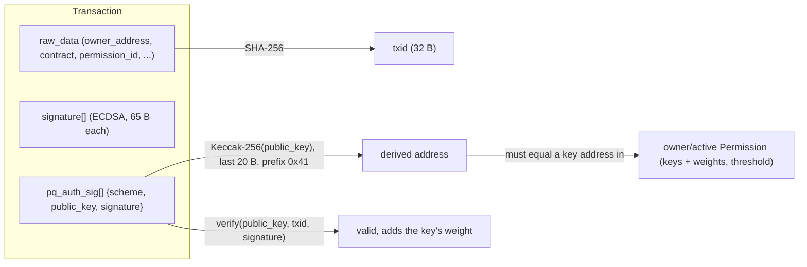

# Post-Quantum Signatures on TRON (TIP-899)

How TRON validates post-quantum (PQ) signatures, how PQ keys and addresses are made, and how a signature
ends up bound to an address. This is a protocol explainer; the SDK parts are in the last section.

> **Experimental.** TIP-899 is a draft and is live only on the Nile testnet (node build
> `4.8.2.3-PQ1-build1`). Mainnet has no PQ support. Both schemes are off by default and switched on by
> governance proposals. Details here can change until the TIP is final.

## Contents

- [The idea in one minute](#the-idea-in-one-minute)
- [Why PQ, and why two schemes](#why-pq-and-why-two-schemes)
- [How a PQ transaction differs from an ECDSA one](#how-a-pq-transaction-differs-from-an-ecdsa-one)
- [Keys and key generation](#keys-and-key-generation)
- [Address derivation](#address-derivation)
  - [Why a PQ address looks exactly like an ECDSA one](#why-a-pq-address-looks-exactly-like-an-ecdsa-one)
  - [Worked example](#worked-example-real-keys-from-nile)
- [Signing](#signing)
- [How the node validates a PQ transaction](#how-the-node-validates-a-pq-transaction)
- [How an address is tied to a PQ key](#how-an-address-is-tied-to-a-pq-key)
- [Multi-signature and migrating an existing account](#multi-signature-and-migrating-an-existing-account)
  - [There is no "claim" step](#there-is-no-claim-step)
  - [Path 1: in-place permission replacement](#path-1-recommended-in-place-permission-replacement)
  - [Path 2: new account and asset migration](#path-2-new-account-and-asset-migration)
  - [Multi-signature in general](#multi-signature-in-general)
- [Activation and limits](#activation-and-limits)
- [Beyond transactions](#beyond-transactions)
- [Observed on Nile](#observed-on-nile)
- [Pitfalls](#pitfalls)
- [In the GoTRON SDK](#in-the-gotron-sdk)
- [Sources](#sources)

## The idea in one minute

- An account is identified by a 21-byte address. The address is a hash of a public key. It does not say which
  kind of key it came from.
- ECDSA transactions carry a 65-byte `signature`. The node recovers the public key from it, hashes it to an
  address, and looks that address up in the account's permission.
- PQ signatures cannot recover the public key. So a PQ transaction carries the **full public key and the
  signature** in a new field, `pq_auth_sig`. The node hashes that key to get an address, finds the address in
  the account's permission, and verifies the signature with the key.
- There is no key registry and no registration transaction. The binding is only "this public key hashes to
  this address".



## Why PQ, and why two schemes

ECDSA (secp256k1) relies on the elliptic-curve discrete-logarithm problem, which a large quantum computer
running Shor's algorithm breaks. Both PQ schemes are **lattice-based**, a family with no known efficient
quantum attack.

| | `FN_DSA_512` | `ML_DSA_44` |
|---|---|---|
| Algorithm | Falcon-512 (NIST FIPS 206, **draft**) | Dilithium2 / ML-DSA-44 (NIST FIPS 204, **final** Aug 2024) |
| Hard problem | NTRU lattices | Module-LWE / Module-SIS |
| Public key | 896 B | 1,312 B |
| Signature | 617–667 B (variable) | 2,420 B (fixed) |
| Rough tx size vs ECDSA | ~9.5x | ~22x |
| `PQScheme` enum value | 1 | 2 |

Falcon is the compact, preferred choice but its standard is still a draft, so it could change. ML-DSA-44 is
implemented in parallel as the fallback. They share one wire format (`PQAuthSig`, differing only in `scheme`),
and each is enabled by its own proposal. On Nile today, `FN_DSA_512` is on and `ML_DSA_44` is off.

## How a PQ transaction differs from an ECDSA one

`Transaction` gains a repeated field (field number 6):

```protobuf
enum PQScheme {
  UNKNOWN_PQ_SCHEME = 0;
  FN_DSA_512        = 1;
  ML_DSA_44         = 2;
  // 3..15 reserved: new schemes need a TIP and a governance proposal
}

message PQAuthSig {
  PQScheme scheme     = 1;
  bytes    public_key = 2;
  bytes    signature  = 3;
}

message Transaction {
  raw                raw_data     = 1;
  repeated bytes     signature    = 2;  // ECDSA, unchanged
  // ... ret = 5 unchanged
  repeated PQAuthSig pq_auth_sig  = 6;  // new
}
```

(`BlockHeader` field 3 and `HelloMessage` field 12 get the same `pq_auth_sig`.)

Important consequences:

- `pq_auth_sig` is **outside `raw_data`**. The txid is still `SHA-256(raw_data)`, so adding or removing
  signatures never changes the txid.
- ECDSA and PQ signatures can sit on the **same** transaction. A multi-sig permission can mix ECDSA, FN-DSA-512
  and ML-DSA-44 signers.
- A PQ-signed transaction usually has an empty `signature` array. Tools that only display `signature` make it
  look unsigned. Look at `pq_auth_sig`.
- A transaction is much bigger: the public key (896 or 1,312 B) is repeated in **every** transaction, because
  nothing on chain stores it.

## Keys and key generation

A PQ key pair is a private key (kept secret), a public key (goes into transactions) and, for ML-DSA, an
optional 32-byte seed from which both can be rebuilt.

### FN-DSA-512 (Falcon-512)

Falcon works over the ring `Z_q[x] / (x^512 + 1)` with `q = 12289`.

1. Sample two short polynomials `f` and `g` (small integer coefficients) with `f` invertible mod `q`.
2. Solve the NTRU equation `f*G - g*F = q` for short `F` and `G`. `(f, g, F, G)` is the **trapdoor**.
3. Compute the public polynomial `h = g * f^-1 mod q`.

Encodings used on TRON (these are protocol rules, not library choices):

| Item | Size | Content |
|---|---|---|
| Public key on the wire | **896 B** | `h`, 512 coefficients x 14 bits. The reference/BouncyCastle `0x09` header byte is **not** included |
| Private key in key files | **1,280 B** | `f` (384 B) ‖ `g` (384 B) ‖ `F` (512 B). The reference `0x59` header is not included |
| Extended private key (wallet-cli) | 2,176 B | `f ‖ g ‖ F ‖ h`, so the public key does not have to be stored separately |

Two Falcon facts that matter in practice:

- **Store the public key with the private key.** Mathematically `h = g * f^-1 mod q` can be computed from the
  private key, but BouncyCastle (which java-tron and wallet-cli use) has no API for it, so TRON tooling
  requires the public key to be supplied. That is why key files carry both, or the 2,176-byte extended form.
- **Key generation is not bit-stable.** It uses floating-point FFT, so the same seed can give different keys
  on different JVMs, CPUs or libraries. A Falcon seed is **not portable**: keep the key itself, not the seed.

### ML-DSA-44 (FIPS 204)

1. A 32-byte seed is expanded with SHAKE256 into `rho` (public seed), `rho'` and `K`.
2. A public matrix `A` is generated from `rho`. Short secret vectors `s1` and `s2` are sampled (coefficients in
   [-2, 2]).
3. Compute `t = A*s1 + s2`, split it into high part `t1` and low part `t0`.

| Item | Size | Content |
|---|---|---|
| Seed | 32 B | the whole key can be rebuilt from it |
| Public key | **1,312 B** | `rho ‖ t1` |
| Private key (expanded) | **2,560 B** | `rho ‖ K ‖ tr ‖ s1 ‖ s2 ‖ t0`, where `tr = SHAKE256(public key)[:64]` |

Unlike Falcon, ML-DSA key generation is integer-only and fully reproducible: the same seed always gives the
same key on every platform, and the public key can be derived from the private key.

## Address derivation

```
address = 0x41 || Keccak-256(public_key)[12:32]      (21 bytes, shown as Base58Check "T...")
```

### Why a PQ address looks exactly like an ECDSA one

A TRON address is never the public key itself. It is a fixed-size **fingerprint** of the public key, and the
fingerprint recipe does not care how long the key is or which algorithm made it. Keccak-256 turns any input
(64 bytes, 896 bytes or 1,312 bytes) into 32 bytes; the rest of the recipe only ever sees those 32 bytes. So
TIP-899 reuses the ECDSA recipe unchanged and simply feeds it the PQ public key:

| Step | ECDSA (secp256k1) | FN-DSA-512 | ML-DSA-44 |
|---|---|---|---|
| 1. Public key | 64 B: the curve point `x ‖ y` (the `0x04` prefix of the uncompressed form is dropped) | 896 B: `h` | 1,312 B: `rho ‖ t1` |
| 2. Hash | Keccak-256 → 32 B | Keccak-256 → 32 B | Keccak-256 → 32 B |
| 3. Keep the last 20 B | bytes 12..31 | bytes 12..31 | bytes 12..31 |
| 4. Prefix `0x41` (TRON mainnet/testnet byte) | 21 B | 21 B | 21 B |
| 5. Base58Check: append the first 4 B of `SHA-256(SHA-256(21 B))`, encode in Base58 | `T...` (34 chars) | `T...` | `T...` |

Only step 1 differs. Steps 2 to 5 are byte-for-byte the code ECDSA addresses have always used, which is why
PQ addresses start with `T`, have the same length, pass the same checksum, and work in every existing tool
that accepts an address (wallets, explorers, `getaccount`, contract calls, permission keys).

Note that "Keccak-256" here is the original Keccak (as in Ethereum), not the later NIST SHA3-256, which pads
differently and gives a different hash.

### Worked example (real keys from Nile)

FN-DSA-512 test account (public key in every transaction it sends):

```
public_key   896 B  4c30111abdc33a54...1496ed75
keccak256     32 B  9afcf8faf20c91f62012bb68409a99cf1f83645d0ec77499c46d31e3072b2032
last 20 B           409a99cf1f83645d0ec77499c46d31e3072b2032
0x41 prefix   21 B  41409a99cf1f83645d0ec77499c46d31e3072b2032
checksum       4 B  a790ff9b
Base58Check         TFroTBvkMwgSAqSE4ycfZB6EtuWUZjiFZU
```

ECDSA test account, same steps:

```
public_key    64 B  b933e580036a3288...21ad3a05
keccak256     32 B  25fdc0e652f5f997330124bc9319e4ddb97f63f65a3af816e2a00e2e6a5e9a0b
last 20 B           9319e4ddb97f63f65a3af816e2a00e2e6a5e9a0b
0x41 prefix   21 B  419319e4ddb97f63f65a3af816e2a00e2e6a5e9a0b
checksum       4 B  57713195
Base58Check         TPP1MQThc5RixXNSbbXGH9q5DEfpKd1XAL
```

### What follows from this

- `public_key` is the exact wire public key (896 B for FN-DSA-512, 1,312 B for ML-DSA-44). For Falcon it is the
  bare `h`, **without** the `0x09` header that some libraries add; hashing the 897-byte form gives a different,
  wrong address.
- The result is an ordinary TRON address. The `Account` structure did not change, and nothing in the address
  says which kind of key produced it.
- The address is one-way: it cannot be turned back into the public key. That is why a PQ transaction must carry
  the public key (ECDSA gets away without it because its public key can be recovered from the signature).
- The three key types live in **one** 160-bit address space, and nothing separates them: all three hash with
  Keccak-256, and a permission key stores only `{address, weight}`, not a scheme. The ECDSA check recovers an
  address from each signature and accepts it if that address is in the permission, so **an ECDSA key whose
  address happened to equal a PQ-derived address would be accepted for it** (and vice versa). Such keys exist
  mathematically, but finding one for a given address is a second-preimage search on a 160-bit hash: about 2^160
  work classically, the same bound that protects every existing TRON address. With Grover's algorithm a quantum
  computer needs about 2^80 sequential steps, each computing a key and a Keccak hash inside the circuit. That is
  far beyond any foreseeable machine and much harder than breaking an exposed ECDSA key, but it means the
  address binding offers roughly 80-bit quantum security, below the signature schemes themselves. It is a
  property of 20-byte addresses; a design that recorded the scheme in each permission key or hashed PQ keys
  differently would close it.
- The node derives the address itself from the key in the transaction. `PQAuthSig` has no address field, so
  there is nothing to forge.

## Signing

What is signed is the same for both PQ schemes, with no prefix:

```
txid = SHA-256(serialized raw_data)       (32 bytes)
signature = Sign(private_key, txid)
```

This is the same 32-byte txid the ECDSA path signs.

### FN-DSA-512

1. Pick a random 40-byte nonce (salt).
2. Hash `nonce ‖ txid` to a polynomial `c` over `Z_q`.
3. Use the trapdoor `(f, g, F, G)` to sample a short pair `(s1, s2)` with `s1 + s2*h = c`.
4. Encode `s2` in Falcon's compressed format.

The wire signature is `0x39 ‖ nonce(40 B) ‖ compressed(s2)`. `0x39` is the header byte (`0x30 + log2(512)`).
The length varies with the data, and TRON allows **617 to 667 bytes**. A signer must **resample** with fresh
randomness until the result fits, up to 16 tries (java-tron's budget), and fail rather than send an
over-length signature. Observed on Nile: 654–655 B.

Verification recomputes `c`, derives `s1 = c - s2*h mod q` from the public key and checks that `(s1, s2)` is
short enough.

### ML-DSA-44

Signing is pure ML-DSA with an **empty context string**: the message is the 32-byte txid and the bytes
actually signed are `0x00 ‖ 0x00 ‖ txid`. The signature is `c~ (32 B) ‖ z (2,304 B) ‖ hint (84 B)` = **2,420 B,
always**. The node signs in hedged mode (fresh randomness), but verification is the same either way, so a
deterministic signature is also valid.

## How the node validates a PQ transaction

From java-tron `Wallet.broadcastTransaction` and `TransactionCapsule`. There are two stages.

**At broadcast** (cheap checks before the transaction enters the pending pool; failures return `SIGERROR`
unless noted):

1. **Total signature count**: `len(signature) + len(pq_auth_sig)` must be ≤ `TOTAL_SIGN_NUM` (5, a fixed
   network constant, not changeable by proposal): `total signature count N exceeds 5`.
2. **ECDSA signature lengths** (unchanged rule).
3. **Is any PQ scheme enabled?** If `pq_auth_sig` is present and neither proposal has passed:
   `pq_auth_sig not allowed: no post-quantum scheme is activated`.
4. **Size bounds** on each `pq_auth_sig` entry: `pq_auth_sig size is out of bounds`.
5. **Pool limits**: `SERVER_BUSY` when the node is overloaded, and `SERVER_BUSY` ("PQ pending pool is full")
   when the PQ-specific pending pool is full.

**Signature validation** (also run when a block is processed, so a node cannot skip it):

1. The PQ-enabled check and the total count are checked again (`too many signatures`).
2. **Resolve the permission** the transaction claims: `raw_data.contract[0].permission_id` (0 = owner,
   2 = default active, others = custom). An account that does not exist yet gets a default permission whose
   only key is its own address.
3. **ECDSA signatures first**: each recovered address is matched against the permission and its weight added.
4. **PQ witnesses**, one by one:
   - `pq_auth_sig` count ≤ number of keys in the permission.
   - No unknown protobuf fields inside the entry (rejected, so nothing can be smuggled in).
   - The entry's scheme must be enabled: `ML_DSA_44 is not allowed` when its proposal is off.
   - Public key length and signature length must match the scheme (sizes above).
   - **Derive the address** from the public key.
   - Reject a repeated address across ECDSA and PQ: `<address> has signed twice!`
   - **Find the address in `permission.keys`**. If it is not there:
     `pq_auth_sig public key derives to <address> but it is not contained of permission`.
   - **Verify the signature** over the txid with that public key (`pq sig invalid` on failure).
   - Add the key's weight (checked for overflow).
5. **Threshold**: the summed weight of all valid ECDSA and PQ signers must be ≥ `permission.threshold`.

The permission id is covered by the signature without any extra step: it is inside `raw_data`, so it is inside
the txid that every signer signs.

## How an address is tied to a PQ key

There are two links, and nothing else:

1. **Key to address** (computed): `address = 0x41 || Keccak-256(public_key)[12:]`.
2. **Address to authority** (stored): the account's `Permission` lists `{address, weight}` entries and a
   `threshold`. A new account's owner permission has one entry: its own address, weight 1, threshold 1.

So when you generate a PQ key, its address already exists as a valid, empty TRON address. The first transfer
**to** it creates the account on chain (the usual account activation, costing the usual fee). From then on, a
transaction **from** it is authorized by presenting the public key that hashes to that address together with a
valid signature. The account never records "I am a PQ account": the key type is decided only by which kind of
signature a transaction presents.

What the chain never stores (in Phase 1) is the public key. This is why it has to travel in every transaction
(ECDSA does not need this, because the public key can be recovered from the signature and the hash). The TIP
sketches a Phase 2 (draft) with a node-side `pq_pubkey` database: the first PQ transaction carries the full
key, later ones only the 21-byte address. That is not implemented on Nile, so today every transaction carries
the key.

## Multi-signature and migrating an existing account

### There is no "claim" step

TIP-899 does **not** define a claim, link or key-rotation transaction, and the node has no mapping from an
old address to a new one. A PQ key has a **different address** from your ECDSA key (their hashes differ), so
it can never authorize the old address by itself. The only way to give a PQ key authority over an existing
account is to **rewrite that account's permission**, and that change must be signed by the account's current
(ECDSA) key. There is no "recover with the new key" fallback, and no way for anyone to claim an address
without a signature the permission already accepts.

Two paths exist (TIP-899, "Account Migration"):

### Path 1 (recommended): in-place permission replacement

One `AccountPermissionUpdateContract` transaction, signed by the account's current owner key, that adds the
PQ-derived address as a permission **key** and changes the weights and threshold so that no ECDSA-only set of
signers can pass. The account keeps its address, balance, staking, delegations, contract bindings and every
external whitelist. Cost: one permission-update fee (plus the normal multi-sign fee for later multi-sig
transactions).

How the PQ key is "associated with the old account": the old account's permission now lists the PQ address.
Nothing else records the relationship.

| Configuration (owner permission) | ECDSA alone passes? | Result |
|---|---|---|
| `keys=[ECDSA w=1, PQ w=1]`, `threshold=1` | **Yes** | **Not safer.** Either key alone is enough, so the ECDSA key still controls the account |
| `keys=[ECDSA w=1, PQ w=1]`, `threshold=2` | No | Hybrid: both signatures required, so an attacker must break both schemes |
| `keys=[ECDSA w=1, PQ w=2]`, `threshold=2` | No (1 < 2) | PQ alone is enough; ECDSA alone is not |
| `keys=[PQ w=1]`, `threshold=1` | n/a | PQ-only. Strongest; the ECDSA key has no authority |

The safe rule: **every passing set of signers must include at least one PQ signature.** `threshold=1` with both
keys at weight 1 looks like a migration but changes nothing.

Steps:

1. Generate a PQ key and note its address. The node only checks that each permission key is a well-formed
   address with a positive weight, so the PQ account does not have to exist on chain yet.
2. Build the permission update with the PQ address as a key (`AccountPermissionUpdateContract`; the SDK has
   `client.UpdateAccountPermission`, and the node accepts PQ-derived addresses as `Key` entries). Pick one of the
   configurations above.
3. Sign it with the **current** key, and broadcast. Check the result with `getaccount` (owner permission).
4. From then on, sign with the PQ key (plus ECDSA where the threshold needs it). The owner permission is
   `permission_id` 0, the default, so owner transactions need nothing extra; set `permission_id` (2 or higher)
   only when signing under an active permission.

Things to watch:

- **The update replaces every permission at once.** `AccountPermissionUpdateContract` must carry the owner
  permission and at least one active permission (and the witness permission for super-representatives), and
  it replaces all of them. Any active permission you submit that the ECDSA key can satisfy alone still lets
  that key do whatever the permission allows (for example transfers), even with a PQ-only owner. Apply the
  safe rule to every permission you submit.
- **Witness permissions take exactly one key**, so a super-representative's block-signing key is either ECDSA
  or PQ, never a hybrid.
- **Your ECDSA public key is probably already public.** It can be recovered from any transaction the account has
  ever signed, so an account that has sent anything is exposed to a future quantum attacker today, not only
  after its next transaction.
- **The update itself is still ECDSA-signed.** Until it lands, the account is as exposed as before. Migrate
  before a quantum attacker is a realistic threat, not after.
- **Test with a small amount first.** A wrong threshold can lock the account: if the PQ key is lost or the
  scheme is later disabled by governance, a PQ-only permission cannot sign. Disabling a scheme is possible
  because the proposals are reversible.
- **The scheme must be enabled** at signing time (`getAllowFnDsa512` / `getAllowMlDsa44`).
- Super-representatives additionally configure `localPqWitness.scheme` / `localPqWitness.keys` on the node
  after the witness permission is switched.

### Path 2: new account and asset migration

The new account has a **different address**: it is derived from the PQ public key, so it looks like any TRON
address (`0x41` prefix, `T...` in Base58) but its value is new, and the old address cannot be moved onto the new
key. Use Path 1 to keep the existing address.

Create a brand-new PQ account, move everything to it (TRX, TRC10, TRC20, and staked or delegated resources,
which must be released through `UnfreezeBalance` / `UnDelegateResource` and wait out the unlock window), then
stop using the old account. This removes the ECDSA exposure completely, but costs transfer fees and unlock
delays, and every external system (exchanges, DApps, bridges, contract whitelists, allowances) has to learn
the new address.

### Multi-signature in general

A permission is just a list of addresses with weights and a threshold, so ECDSA and PQ signers can be mixed
freely. Examples:

- *PQ-only control*: the PQ address is the only key, threshold 1.
- *Hybrid 2-of-2*: one ECDSA key and one PQ key, each weight 1, threshold 2. Both signatures are needed.
- *Mixed multi-party*: any combination of ECDSA, FN-DSA-512 and ML-DSA-44 signers, up to 5 signatures in total.

The signature count limit of 5 applies across ECDSA and PQ together, and a key cannot be used twice.
`wallet/getsignweight` already counts PQ witnesses on the node, so the same call tells you whether a partly
signed transaction has enough weight.

## Activation and limits

- Two governance proposals, each only `0` or `1`, reversible, available from node version flag
  `VERSION_4_8_2_PQ1`:

  | Proposal | Code | Chain parameter key |
  |---|---|---|
  | `ALLOW_FN_DSA_512` | 1000 | `getAllowFnDsa512` |
  | `ALLOW_ML_DSA_44` | 1001 | `getAllowMlDsa44` |

  Nodes without TIP-899 (mainnet today) do not report these keys at all. Clients should treat a missing key and
  `0` as "off".
- **Bandwidth.** The node adds the full PQ signature wire size to a transaction's bandwidth cost, so PQ
  transactions cost far more bandwidth than ECDSA ones. Fund PQ accounts accordingly. `getCanDelegatedMaxSize`
  takes a `pq_scheme` so delegation estimates include it.
- **Throughput caps.** A pending-pool cap for PQ transactions (`SERVER_BUSY` when full) and a hard limit of
  1,000 PQ transactions per block.

## Beyond transactions

The same `PQAuthSig` is also used for:

- **Block production**: `BlockHeader.pq_auth_sig`, for super-representatives that sign blocks with a PQ key
  (configured with `localPqWitness`, separate from the ECDSA witness key).
- **Node handshakes**: `HelloMessage.pq_auth_sig`.
- **Smart contracts**: precompiles to verify PQ signatures inside the TVM: `0x02000016` `VerifyFnDsa512`,
  `0x02000017` `BatchValidateFnDsa512`, `0x02000018` `VerifyMlDsa44`, `0x02000019` `BatchValidateMlDsa44`,
  `0x0200001a` `ValidateMultiPQSig` (ECDSA plus any PQ scheme, up to 5 entries).

The SDK only signs transactions; block and handshake signing are node concerns.

## Observed on Nile

Real transactions made with the SDK (FN-DSA-512). Fetched from the node, nothing mocked.

| What | Value |
|---|---|
| Transfer | `bbe1f6c28c3ed7a0e7c6cfa8e381e947da5d97c22f8ec32ce38e43edf5dbf196` |
| `signature` entries | 0 |
| `pq_auth_sig` entries | 1: `FN_DSA_512`, public key 896 B, signature 654 B |
| Address from the key | `Keccak-256(public_key)` gives `TFroTBvkMwgSAqSE4ycfZB6EtuWUZjiFZU`, equal to the transfer's `owner_address` |
| Signature check | verifies over `sha256(raw_data)` = the txid |
| Sign weight | `ENOUGH_PERMISSION`, current weight 1 |
| ML-DSA-44 | refused by the node: `SIGERROR: ML_DSA_44 is not allowed` |
| Cost | ~1.76 TRX burned for bandwidth per PQ transfer (about 1,760 bytes, no staked bandwidth), with no multi-sign fee |

### Migrating an ECDSA account to PQ-only (Path 1)

An ECDSA account `TPP1MQThc5RixXNSbbXGH9q5DEfpKd1XAL` was migrated in place to a single FN-DSA-512 key
(`TYqTJs1ty1M6jnfr2Fn76GJyPKsuKz925f`):

| Step | Result |
|---|---|
| Before | owner and active permissions: the account's own address (its ECDSA key), weight 1, threshold 1 |
| `AccountPermissionUpdateContract`, signed by the ECDSA key | `3b33393d0ec9dd9c9863a8dabcb65c00380b52dd0f9fe5981c8cec3683e0d0ce`; Nile charged the 100 TRX permission-update fee |
| After | owner (id 0) and active (id 2) permissions: only the PQ address, weight 1, threshold 1. **The account address is unchanged** |
| Transfer signed by the PQ key, owner permission | accepted: `74acaa14bf20c19c345510a9c79bd0e739e9f234fd9d80a4fa59bf52f14e8d3a` |
| Transfer signed by the PQ key, active permission (`permission_id` 2) | accepted: `7bba8db669234acf00653d9c1b57843dbc46461afc478a472e9d07ed34b1a1ac` |
| Transfer signed by the **old ECDSA key** | refused: `... is signed by TPP1MQThc5RixXNSbbXGH9q5DEfpKd1XAL but it is not contained of permission` |

The PQ key's own address never needed to exist on chain: it appears only as a key inside the migrated account's
permissions.

JSON shape returned by the node (bytes are lowercase hex, the enum is printed by name):

```json
{
  "txID": "bbe1f6c2...",
  "raw_data": { "...": "..." },
  "raw_data_hex": "...",
  "pq_auth_sig": [
    { "scheme": "FN_DSA_512", "public_key": "4c30111a...", "signature": "39..." }
  ]
}
```

## Pitfalls

- **Explorers and wallets** that only read `signature` show a PQ transaction as unsigned. The data is in
  `pq_auth_sig`.
- **FN-DSA-512 seeds are not portable.** Back up the private key and the public key, not the seed.
- **897-byte and 1,281-byte Falcon keys** (with the `0x09` / `0x59` header bytes, as liboqs and the reference
  code produce) are not valid on the TRON wire. Strip the header byte when importing, and add it back only for
  a library that needs it.
- **Two signature encodings.** The transaction signature is the headed form (`0x39 ...`). The TVM precompiles
  use a different headerless, zero-padded 666-byte form. Do not mix them.
- **Do not reuse a key twice** on one transaction, and mind the 5-signature limit across ECDSA and PQ.
- **Everything else is unchanged**: balances, staking, resources, account names and contracts work as before.
  Permissions work as before too; they simply accept PQ-derived addresses as keys.
- **Draft status.** Wire details, sizes and activation can change before mainnet.

## In the GoTRON SDK

| Need | Where |
|---|---|
| Key types, address, parse, Toolkit JSON and wallet-cli keystore import/export | `pkg/pqc` (`GenerateKey`, `ParsePrivateKey`, `PublicKey.Address`, `MarshalToolkitJSON`, `EncryptKeystore`) |
| Sign a transaction | `signer.NewPQSigner(key)` (implements `signer.Signer`), or `signer.SignTransactionPQ` / `transaction.SignTransactionPQ` |
| Ask the node which schemes are enabled | `client.GetPQCapabilities`, `PQSchemeAllowedCtx` |
| Refuse early when a scheme is off | `txcore.Send` checks automatically for PQ signers (`txcore.ErrPQSchemeDisabled`) |
| Transaction JSON with `pq_auth_sig` | `transaction.ToJSON` / `FromJSON` |
| Bandwidth estimate for PQ | `client.GetCanDelegatedMaxSizePQ` |
| Wipe a key from memory (best effort) | `pqc.PrivateKey.Destroy()` |

Build notes: ML-DSA-44 is pure Go. FN-DSA-512 signing **and verifying** need the `falcon` build tag, CGO and
[liboqs](https://openquantumsafe.org/liboqs/) (`make test-falcon` runs those tests). Without it, FN-DSA-512 keys
still parse, addresses still derive and key pairs are still validated, but `Sign` and `Verify` return
`pqc.ErrFalconUnavailable` (a pure-Go verifier is planned).

## Sources

- TIP-899, "Post-quantum signature support" (draft).
- java-tron Nile build `GreatVoyage-Nile-v4.8.2.3-PQ1-build1`: `TransactionCapsule.validatePQSignatureGetWeight`,
  `PQSchemeRegistry`, `Wallet.broadcastTransaction`.
- NIST FIPS 204 (ML-DSA) and FIPS 206 draft (FN-DSA); Falcon round-3 specification.
